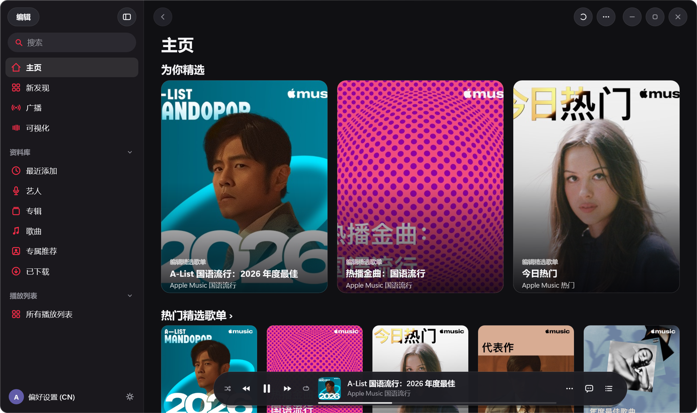
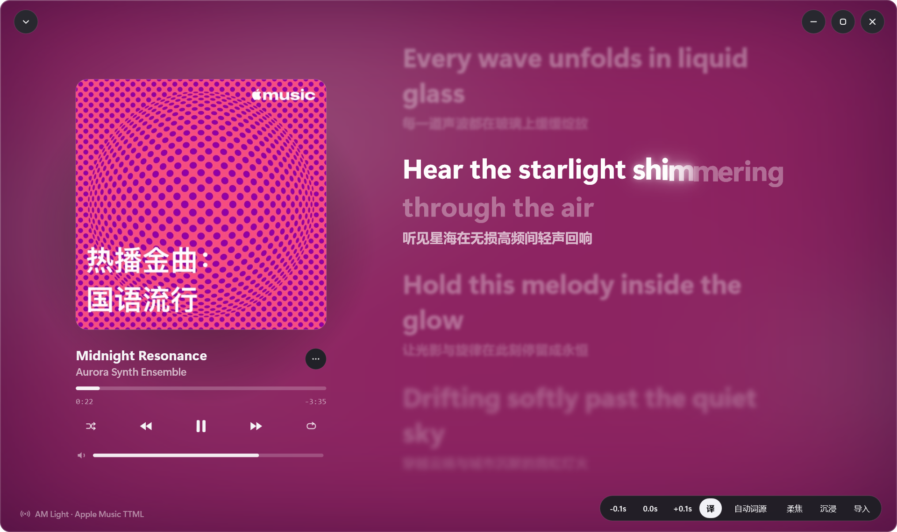
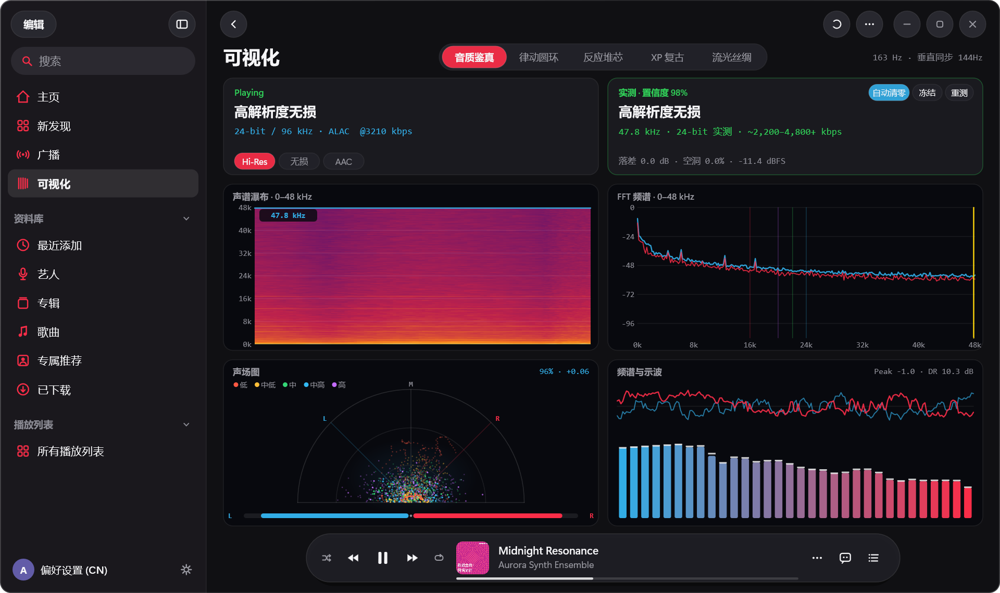
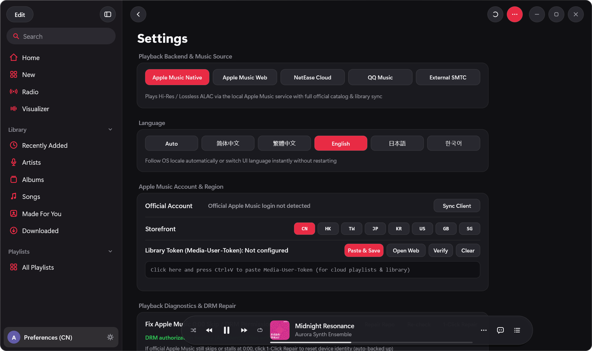

<div align="center">


# AM Light

**原生 Rust + Direct2D / DirectComposition 打造的轻量级多平台桌面音乐播放器**  
亚像素逐字歌词 · 实时 WASAPI 音频鉴真可视化 · 五大播放后端 · 视口动态封面 · 五国界面语言

<p>
  <a href="https://github.com/N20xDuli/AM-Light/releases">
    
  </a>
  
  
  
  <a href="LICENSE">
    
  </a>
</p>

<p>
  <strong>简体中文</strong> · <a href="README_EN.md">English</a>
</p>

<br />



</div>

> [!WARNING]
> **重要免责与稳定性声明（使用前请仔细阅读）**
> - 本项目当前处于 **不稳定版本（Unstable / Experimental）**，可能存在各类界面、兼容性或播放同步问题（Bug）。
> - 本项目由个人维护，**随时有可能停止更新（断更）或直接删除、下架消失**，不承诺长期维护、功能可用性或问题响应。
> - 本软件及内置工具仅供个人学习与技术研究使用，**作者及贡献者不对因下载、安装或使用本项目所造成的任何直接、间接后果（包括但不限于系统异常、账号风险或数据损失）承担任何责任**。使用即代表您已了解并自行承担全部风险。

---

## 界面预览

<table>
  <tr>
    <td align="center" width="50%">
      
      <br />
      <sub><b>流光背景与亚像素逐字歌词</b> · 封面取色极光网格、GPU 景深柔焦、强调光效与沉浸模式</sub>
    </td>
    <td align="center" width="50%">
      
      <br />
      <sub><b>WASAPI 实时音频鉴真与可视化</b> · 0–48 kHz 声谱瀑布、FFT 频谱、五频段声场散点与示波</sub>
    </td>
  </tr>
  <tr>
    <td align="center" width="50%">
      
      <br />
      <sub><b>原生 Direct2D 暗色磨砂主页</b> · 视口自适应动态封面、悬浮迷你播放器与弹簧侧栏</sub>
    </td>
    <td align="center" width="50%">
      
      <br />
      <sub><b>多播放后端 & 多语言设置（English 示例）</b> · 五大音源热切换、五国语言即时生效与内置 DRM 诊断</sub>
    </td>
  </tr>
</table>

---

## 核心特性

### v0.2.12 完整歌单同步、系统媒体控制与全链路性能重构

- **突破百首/两百首限制的完整云端歌单同步 & 封面精准匹配**：Apple Music 个人资料库/目录歌单全量分页拉取并分批写入（彻底解除 100 首截断）；网易云歌单基于完整 `trackIds` 批量拉取并严格保序（彻底解除 200 首截断）；全面修复播放中 / 歌单 / SMTC 封面串图与过期异步回写。
- **原生 Windows SMTC 媒体发布器 & 结构化运行/崩溃日志**：内置系统级 SMTC 媒体卡片与全局快捷键/时间轴双向同步（带自环防护），并新增按日滚动的轻量级运行与异常日志（`%APPDATA%\AMLight\logs`）。
- **DXVA 硬件解码动态封面 & 液态玻璃 7.5× 显存削减**：主页经典卡片比例保持不变，支持最多 20 路视口动态封面平滑窗口与 2-slot DXVA 零拷贝乒乓缓冲；液态玻璃重构为单通道条带缩放与目标屏障（显存由 ~20.4 MB 降至 ~2.7 MB），新增 O(1) 真 LRU 纹理/字形缓存。
- **全链路 P0/P1/P2 低耗性能重构**：O(1) 数据版本号指纹哈希、零克隆弹窗与 `Arc` 共享歌单磁盘缓存、可即时取消的 HLS/FLAC 流下载与 100% 缓存命中复用、暂停 0 Hz WASAPI 静默休眠、非主页自适应低帧率调度以及零堆分配本地即时搜索。

### 多播放后端与跨平台歌单复制

在 **「设置 -> 播放后端与音乐源」** 一键切换音源，主页、新发现、电台、搜索与曲库视图自动适配对应平台；支持不同平台间歌单**逐首智能匹配与一键复制**。

| 播放后端 | 播放链路 | 核心能力 |
| :--- | :--- | :--- |
| **Apple Music 原生** | 本地微软商店版 `AMPLibraryAgent` | Hi-Res 无损 / ALAC 完整曲库、内置 DRM 一键修复、个人资料库同步 |
| **Apple Music 网页版** | 本机 Edge 独立配置 + MusicKit JS | 免安装微软商店客户端、Widevine 完整播放、自动同步网页 Token |
| **网易云音乐** | MediaFoundation + WASAPI 原生直出 | 原生 Direct2D 扫码/Cookie 登录与 VIP 等级展示、**一起听（与手机端互通、口令短链加入、互关一键邀请）**、YRC 逐字歌词 |
| **QQ 音乐** | MediaFoundation + WASAPI 原生直出 | 巅峰榜 / 新歌 / 电台浏览、Cookie 解锁高音质并在无权限时平滑降级 |
| **外置 SMTC 接管** | Windows SMTC 系统媒体会话 | 零焦点抢占接管 Spotify / 浏览器 / 任意播放器，完整复用歌词与可视化 |

### 原生多语言界面（免重启即时生效）

- 内置 **简体中文**、**繁體中文**、**English**、**日本語**、**한국어** 五种界面语言，并支持 **Auto（自动跟随 Windows 系统区域）**。
- 在 **「设置 -> 界面语言」** 点击即可在下一帧立即切换全站 UI 文案，并自动同步 Apple Music 目录请求语言；同时严格保护曲名、艺人名、专辑名与歌词原文不被误改。

### 原生 Direct2D / DirectComposition UI & iPadOS 26 液态玻璃

- **重构 iPadOS 26 光学液态玻璃（默认开启）**：基于 `R16G16B16A16_FLOAT` 16-bit 浮点 C2 五次 SDF 透镜位移、每帧单次半分辨率预模糊快照、纯上下垂直镜面高光与悬停/按压弹性弹簧动效，在 100%–200% HiDPI 下通透无断层、高帧流畅。
- **全站内置 OFL Inter Variable 字体**：通过 DirectWrite 内存加载器 100% 覆盖西文与数字排版，时间轴与指标采用 `tnum=1 / zero=0` 等宽无斜线数字 `0`，中文与 Emoji 无缝回落系统字体。
- **纯黑扁平 iPadOS 风格设置页 & SWR 页面缓存加速**：设置页完全禁用液态玻璃以实现超低 GPU 占用，采用居中分组卡片、Apple 绿拨动开关与扁平分段控件；内置 SWR 内存缓存（支持开关与一键清空/刷新）与并行拉取，大幅消除切页“加载中”等待。
- **无边框可调圆角窗口 & 视口自适应动态封面**：支持 `0..28 px` 精细圆角调节；主页与详情页动态封面滚动入屏即时播放、离屏自动暂停释放解码器；统一 `•••` 上下文菜单与完整艺人详情页。

### 亚像素逐字/逐词歌词与全新交互

- 支持 **TTML / YRC / LRC** 多格式解析，采用 `DWRITE_RENDERING_MODE_NATURAL_SYMMETRIC` 亚像素排版平滑上浮，区分象形文字逐字与西文按词动效，支持强调词柔光放大、尾字停留渐亮与播完防回顶锁定。
- **无缝流光极光背景 & 精简控件**：重构“流光 / 柔焦”背景彻底消除边缘方角；移除播控与 `•••` 圆形边框，右下角精简为 **「翻译 / 歌词 / 播放列表」** 三图标胶囊，右侧支持交互式待播清单滚动切歌。
- **升级左侧 `•••` 歌词菜单**：集成行内歌词偏移微调器（`- / 0.0s / +`）、**左侧放大显示**、**歌词中轴居中**、词源切换、流光/柔焦切换、**歌词沉浸模式**开关与本地歌词导入。

### WASAPI 实时音频可视化与高刷低耗调度

- **五大可视化视图**：**音质鉴真**（实测频谱上限 / MDCT 空洞率 / 位深检测 + 0–48 kHz 声谱瀑布 + 五色/单色声场散点图）、**律动圆环**（多频段 Onset 节拍锁定）、**反应堆芯**、**XP 复古** 与 **流光丝绸**。
- **分页面自适应帧率调度**：可分别为可视化页与歌词页独立配置 `60`、`72`、`自适应 [60/72]`（自动识别 144Hz / 240Hz 等显示器切换最优整除帧率）、`垂直同步` 与 `自定义 (30..360 Hz)`。
- **低资源占用**：静默待机时自动回落至内核事件休眠，面向静态低内存与低 CPU/GPU 占用设计。

---

## 快速上手

### 第一步：准备播放后端（Apple Music 原生模式前置条件）

若使用默认的 **Apple Music 原生** 模式（通过微软商店版官方 Apple Music 本地播放服务实现无损流媒体播放），请先完成以下初始化：

1. 前往 **Microsoft Store** 安装官方 **Apple Music（Windows 版）**。
2. 打开原版 Apple Music 并登录拥有有效订阅的 **Apple ID**。
3. 在原版客户端中**任意播放一首歌曲**确认正常出声（用于完成首次 FairPlay / ADI 设备授权初始化）。
4. 确认可播放后即可关闭或最小化原版窗口，启动 **AM Light** 使用。

> [!TIP]
> **不想安装微软商店版 Apple Music？**  
> 您也可以直接启动 AM Light，前往 **「设置 -> 播放后端与音乐源」** 切换至 **Apple Music 网页版**、**网易云音乐**、**QQ 音乐** 或 **外置 SMTC**。

### 若原版 Apple Music 无法播放 / 点歌秒切

如果您的电脑曾使用过部分第三方 iOS 签名工具（如 Sideloadly、爱思助手等），导致原版 Apple Music 出现**点歌秒切下一首、进度停在 `0:00` 且无声音**的 DRM 故障：

- **方式一（内置工具）**：打开 AM Light **「设置 -> 播放故障诊断与 DRM 修复」**，支持无管理员权限快速检测，并可点击 **「一键修复」**（自动备份旧文件与 ACL/注册表、修复 `%ProgramData%\Apple Computer` 写入权限并清理第三方 DRM 重定向）。
- **方式二（独立开源项目）**：参考作者维护的独立排查修复工具：  
  https://github.com/N20xDuli/apple-music-windows-drm-fix

### 第二步：下载与安装

1. 前往 [**GitHub Releases**](https://github.com/N20xDuli/AM-Light/releases) 下载最新的 Windows x64 安装包（如 `AM-Light-Setup-v0.2.12-x64.exe`）并运行安装。
   - 静默安装：`AM-Light-Setup-v0.2.12-x64.exe --silent [--dir="C:\Path\To\AM-Light"]`
   - 卸载方式：通过 Windows「已安装的应用」或安装目录下的 `Uninstall-AM-Light.exe` 卸载。
2. 启动 AM Light，在 **「设置」** 中可随时切换播放后端与界面语言。

### 第三步：同步云端歌单与个人资料库（可选）

- **Apple Music**：在浏览器登录 https://music.apple.com，从开发者工具复制 `media-user-token`（或完整 Cookie），在 **「设置 -> Apple Music 账号与地区」** 点击 **「粘贴保存」** 并 **「验证」**；若使用「Apple Music 网页版」后端，登录后可一键 **「同步网页 Token」**。
- **网易云音乐**：在 **「设置 -> 网易云音乐账号与音质」** 点击 **「扫码登录」**，使用手机 App 扫码即可同步歌单、每日推荐与 VIP 音质。
- **QQ 音乐**：在 **「设置 -> QQ 音乐账号与音质」** 粘贴浏览器 Cookie（含 `uin` 与 `qm_keyst`）即可同步个人歌单与高音质。
- **隐私说明**：所有账号凭据、Token 与本地缓存**仅保存在您本机用户目录**，本仓库与发行安装包中不包含任何个人会话或凭据。

---

## 环境要求

- **操作系统**：Windows 10 / Windows 11（64 位 x64）
- **显卡支持**：支持 Direct3D 11 / Direct2D 硬件加速（无硬件加速时自动回退 WARP）
- **可选前置**：若使用「Apple Music 原生」后端，需安装并登录 Microsoft Store 版 Apple Music

---

## 从源码构建

需要 Rust 工具链（`x86_64-pc-windows-gnu` 或 MSVC）；若使用 GNU 工具链需安装 MinGW-w64 并确保 `windres` 在 `PATH` 中。

```powershell
# 运行全部单元测试（Release，单线程避免共享时钟竞争）
cargo test --release --bin AM-Light -- --test-threads=1

# 构建主程序（Release）
cargo build --release --bin AM-Light

# 打包 Windows 安装器（输出至 dist\AM-Light-Setup-v0.2.12-x64.exe）
$env:AM_LIGHT_BIN_PATH = "target\release\AM-Light.exe"
cargo build --release --manifest-path installer\Cargo.toml
```

---

## 致谢与参考

- 本项目的歌词解析、时间轴校准、逐字动效曲线与双通道模糊流光界面**参考了 LyricsBlossom 的实现及其作者公开分享的技术资料**，在此致以诚挚感谢。
- Apple Music Windows 版无法播放 / 点歌秒切诊断与内置 DRM 修复逻辑集成自：[N20xDuli/apple-music-windows-drm-fix](https://github.com/N20xDuli/apple-music-windows-drm-fix)。
- 内置拉丁/数字界面字体采用开源字体 **Inter**（[SIL Open Font License 1.1](assets/fonts/OFL.txt)）。

---

## 开源协议

本项目基于 **MIT License** 开源，完整协议文本请参阅 [LICENSE](LICENSE)。
