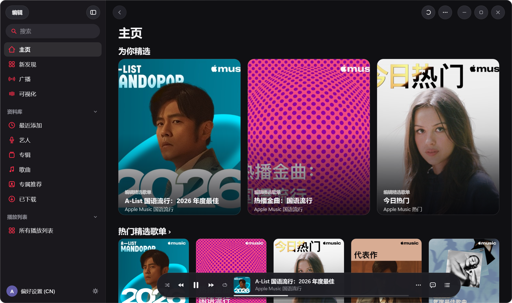
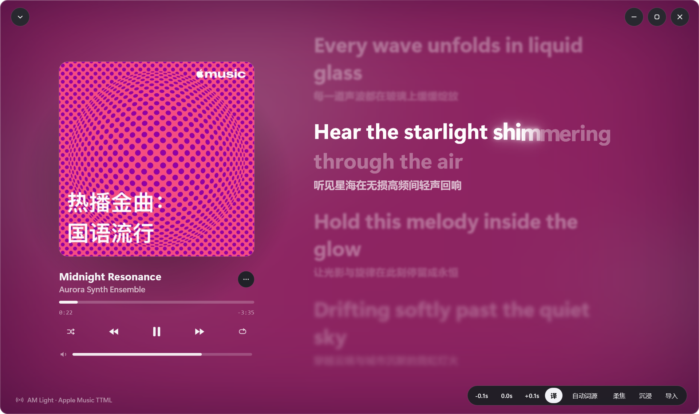
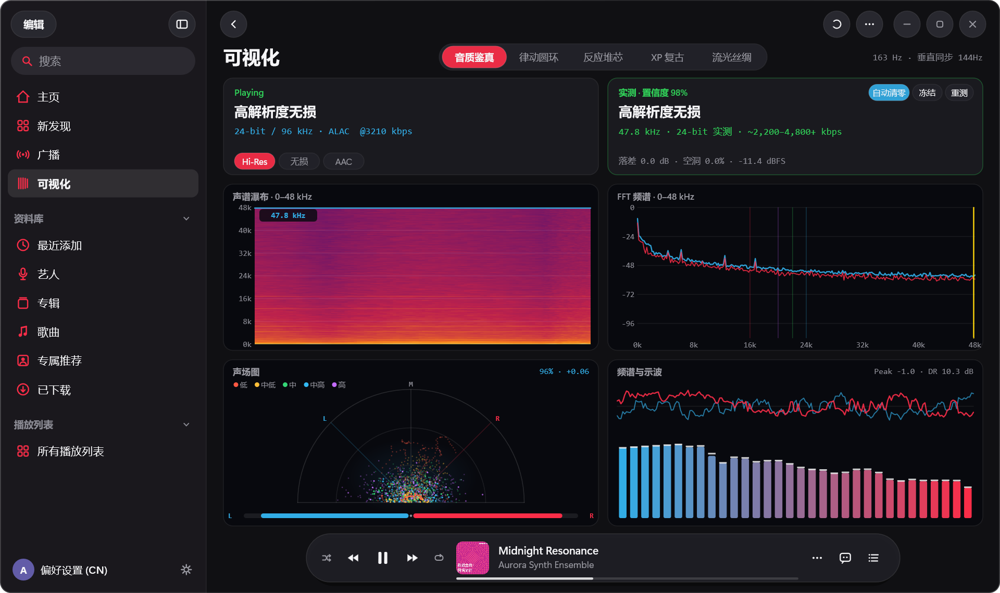
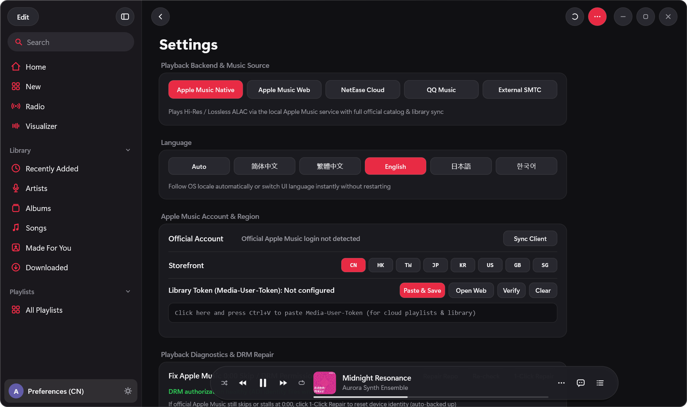

<div align="center">


# AM Light

**Lightweight Native Multi-Backend Desktop Music Player Built with Rust & Direct2D / DirectComposition**  
Subpixel Word-Synced Lyrics · Real-Time WASAPI Audio Inspector · 5 Playback Backends · Viewport Motion Art · 5 UI Languages

<p>
  <a href="https://github.com/N20xDuli/AM-Light/releases">
    
  </a>
  
  
  
  <a href="LICENSE">
    
  </a>
</p>

<p>
  <a href="README.md">简体中文</a> · <strong>English</strong>
</p>

<br />



</div>

> [!WARNING]
> **Important Stability & Disclaimer Notice (Please Read Before Use)**
> - This project is currently **Unstable / Experimental** and may exhibit UI, compatibility, or playback synchronization bugs.
> - This project is maintained independently and **may stop receiving updates, be archived, or be removed at any time** without notice or long-term support guarantees.
> - This software and its built-in utilities are intended solely for personal learning and technical research. **The author and contributors assume no liability for any direct or indirect consequences** (including system issues, account risks, or data loss) arising from downloading, installing, or using this project. By using it, you accept all risks.

---

## Visual Preview

<table>
  <tr>
    <td align="center" width="50%">
      
      <br />
      <sub><b>Aurora Mesh & Subpixel Word Lyrics</b> · Artwork-extracted aurora canvas, GPU Gaussian depth blur, emphasis glow & Immersive Mode</sub>
    </td>
    <td align="center" width="50%">
      
      <br />
      <sub><b>Real-Time WASAPI Audio Inspector</b> · 0–48 kHz spectrogram waterfall, FFT curve, 5-band soundstage & stereo oscilloscope</sub>
    </td>
  </tr>
  <tr>
    <td align="center" width="50%">
      
      <br />
      <sub><b>Native Direct2D Home Showcase</b> · Viewport-adaptive animated covers, floating MiniPlayer & spring sidebar</sub>
    </td>
    <td align="center" width="50%">
      
      <br />
      <sub><b>Multi-Backend & Multi-Language Settings</b> · Instant 5-backend switching, 5 UI languages with live reload & built-in DRM diagnostics</sub>
    </td>
  </tr>
</table>

---

## Key Features

### Multi-Backend Playback & Cross-Platform Playlist Transfer

Switch seamlessly between **5 playback backends** under **Settings → Playback Backend & Music Source**. Home, New, Radio, Search, and Library pages automatically adapt to the active platform, with **track-by-track cross-platform playlist matching and copying**.

| Backend | Playback Engine | Highlights |
| :--- | :--- | :--- |
| **Apple Music Native** | Official Store `AMPLibraryAgent` IPC | Hi-Res Lossless / ALAC playback, built-in 1-Click DRM repair, cloud library sync |
| **Apple Music Web** | Isolated Edge + MusicKit JS | No Store client required, Widevine playback, 1-click Web Token sync |
| **NetEase Cloud** | Native MediaFoundation + WASAPI | Built-in Direct2D QR/Cookie login & VIP badge, **Listen Together (phone cross-sync, short-link join, mutual friend invites)**, YRC word lyrics |
| **QQ Music** | Native MediaFoundation + WASAPI | Top Charts / Radio / Search, browser Cookie unlock with graceful quality fallback |
| **External SMTC** | Windows System Media Transport | Non-intrusive bridge for Spotify, browsers, or any player with full lyrics & visualizer |

### Native Multi-Language Support (Zero-Restart Live Switch)

- Ships with **5 full UI languages**: **简体中文**, **繁體中文**, **English**, **日本語**, and **한국어**, plus **Auto** (detects Windows UI locale via `GetUserDefaultUILanguage`).
- Switching under **Settings → Language** takes effect on the very next frame without restarting, also localizing Apple Music editorial catalog requests while keeping song titles, artist names, album names, and lyrics completely untouched.

### Native Direct2D / DirectComposition UI & Liquid Glass

- **Frameless customizable window** (`0..28 px` adjustable corner radius) with single-pass backdrop-snapshot **Liquid Glass** buttons and diagonal specular border rim.
- **Viewport-Adaptive Motion Artwork**: Smooth animated covers on both Home shelves and Album/Playlist Detail pages — plays automatically when scrolled into view and pauses immediately off-screen with zero flicker.
- **Unified `•••` Context Menus & Artist Profiles**: Play Next, Add to Playlist, Cross-Platform Playlist Transfer, Go to Artist (Top Songs + Full Discography), and Go to Album across every view.

### Subpixel Word-Level Lyrics & Immersive Mode

- Supports **TTML / YRC / LRC** parsing with live timing offset controls and `DWRITE_RENDERING_MODE_NATURAL_SYMMETRIC` subpixel positioning.
- Distinct **CJK per-character** and **Latin per-word** sweep physics, emphasis glow & scale, toggleable end-hold glow, centered instrumental indicators, and dual-pass GPU Gaussian depth-of-field blur.
- **Lyrics Immersive Mode**: Cleanly hides all corner chrome so only the cover, playback controls, and synced lyrics remain — revealing corner controls smoothly as the cursor approaches.

### Real-Time WASAPI Visualizer & Adaptive High-Refresh Pacing

- **5 Visualizer Modes**: **Audio Inspector** (live cutoff frequency, MDCT hole ratio, bit-depth verdict, 0–48 kHz spectrogram waterfall & 5-band multicolor/mono soundstage), **Rhythm Ring** (multi-band onset beat lock), **Reactor Core**, **Retro XP**, and **Aurora Ribbon**.
- **Per-Page Display-Adaptive FPS**: Independently configure Visualizer and Lyrics refresh targets (`60`, `72`, `Adaptive [60/72]` for 144 Hz / 240 Hz monitors, `VSync`, or `Custom 30–360 Hz`).
- **Low Footprint**: Event-driven idle hibernation keeps background CPU/GPU near zero with a compact native memory footprint.

---

## Quick Start

### Step 1: Prerequisites for Apple Music Native Mode

When using the default **Apple Music Native** backend (powered by the official Microsoft Store Apple Music local playback service):

1. Install the official **Apple Music** app from the **Microsoft Store**.
2. Open the official app and sign in with an **Apple ID** that has an active subscription.
3. **Play any song once** in the official app and confirm audio plays normally (this initializes FairPlay / ADI device credentials).
4. Once confirmed, you can close or minimize the official app and use **AM Light** for everyday listening.

> [!TIP]
> **Prefer not to install the Store Apple Music app?**  
> Launch AM Light directly and go to **Settings → Playback Backend & Music Source** to switch to **Apple Music Web**, **NetEase Cloud**, **QQ Music**, or **External SMTC**.

### Fixing Official Apple Music 0:00 Stall / Instant Track Skip (DRM)

If third-party iOS signing tools (e.g., Sideloadly) or broken folder ACLs cause official Apple Music to **skip tracks immediately or stall at `0:00` with no sound**:

- **Option 1 (Built-in Tool)**: Go to **Settings → Playback Diagnostics & DRM Repair** for a non-elevated health check, then click **1-Click Repair** (automatically backs up existing files/ACLs/registry entries, restores `%ProgramData%\Apple Computer` write permissions, and clears third-party DRM redirections).
- **Option 2 (Standalone Repair Repo)**: See the dedicated open-source troubleshooting project:  
  https://github.com/N20xDuli/apple-music-windows-drm-fix

### Step 2: Download & Install

1. Download the latest Windows x64 installer (e.g., `AM-Light-Setup-v0.2.10-x64.exe`) from [**GitHub Releases**](https://github.com/N20xDuli/AM-Light/releases).
   - Silent install: `AM-Light-Setup-v0.2.10-x64.exe --silent [--dir="C:\Path\To\AM-Light"]`
   - Uninstall via Windows **Installed Apps** or `Uninstall-AM-Light.exe` inside the install folder.
2. Launch AM Light and configure your preferred playback backend and UI language under **Settings**.

### Step 3: Cloud Library & Playlist Sync (Optional)

- **Apple Music**: Sign in at https://music.apple.com, copy your `media-user-token` (or full Cookie string) from browser DevTools, then click **Paste & Save** and **Verify** in **Settings → Apple Music Account & Region** (or click **Sync Web Token** after signing in via the Web backend).
- **NetEase Cloud**: Click **QR Login** under **Settings → NetEase Account & Quality** and scan with the mobile app to sync playlists, Daily Picks, and VIP audio quality.
- **QQ Music**: Paste your browser Cookie (`uin` + `qm_keyst`) under **Settings → QQ Music Account & Quality**.
- **Privacy**: All credentials, tokens, and local caches are stored **strictly on your local machine**. Neither this repository nor any release binary contains personal sessions or tokens.

---

## Requirements

- **OS**: Windows 10 / Windows 11 (x64)
- **Graphics**: Direct3D 11 / Direct2D capable GPU (automatic WARP fallback if unavailable)
- **Optional**: Official Microsoft Store **Apple Music** app (only required for the *Apple Music Native* backend)

---

## Building from Source

Requires the Rust toolchain (`x86_64-pc-windows-gnu` or MSVC). On GNU toolchains, ensure MinGW-w64 (`windres`) is available in `PATH`.

```powershell
# Run all unit tests (Release, single-threaded for shared playback clock tests)
cargo test --release --bin AM-Light -- --test-threads=1

# Build main executable (Release)
cargo build --release --bin AM-Light

# Build Windows installer (outputs to dist\AM-Light-Setup-v0.2.10-x64.exe)
$env:AM_LIGHT_BIN_PATH = "target\release\AM-Light.exe"
cargo build --release --manifest-path installer\Cargo.toml
```

---

## Acknowledgements

- Lyric parsing, timeline calibration, word-level motion physics, and the dual-pass blurred aurora lyrics presentation draw inspiration from **LyricsBlossom** and the technical notes shared by its author — sincere thanks for their work.
- Built-in Apple Music Windows DRM diagnostics and repair flow are integrated from [N20xDuli/apple-music-windows-drm-fix](https://github.com/N20xDuli/apple-music-windows-drm-fix).

---

## License

Released under the **MIT License**. See [LICENSE](LICENSE) for details.
